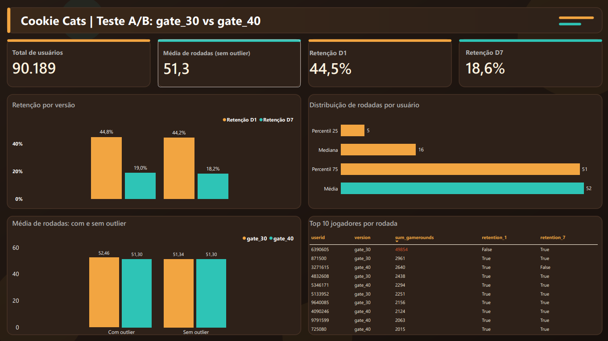

# Cookie Cats | Teste A/B: gate_30 vs gate_40

Análise de um teste A/B de um jogo mobile para avaliar se mover o primeiro "gate" (bloqueio) do nível 30 para o nível 40 afeta o engajamento e a retenção dos jogadores. O projeto percorre o fluxo completo de um analista de dados: validação em SQL, análise estatística em Python e dashboard em Power BI.



## Contexto

No jogo Cookie Cats, os jogadores encontram "gates" que os obrigam a esperar ou a pagar para continuar. O teste dividiu os jogadores em dois grupos:

- **gate_30:** o primeiro gate aparece no nível 30.
- **gate_40:** o primeiro gate aparece no nível 40.

**Pergunta de negócio:** mover o gate para o nível 40 melhora ou piora a retenção e o engajamento?

## Dados

Dataset público do Cookie Cats (Kaggle), com 90.189 jogadores.

| Coluna | Descrição |
|---|---|
| `userid` | Identificador único do jogador |
| `version` | Grupo do teste (`gate_30` ou `gate_40`) |
| `sum_gamerounds` | Total de rodadas jogadas na primeira semana |
| `retention_1` | Jogador voltou 1 dia após a instalação |
| `retention_7` | Jogador voltou 7 dias após a instalação |

## Ferramentas

- **Python** (Pandas, SQLAlchemy, PyMySQL): carga dos dados e análise exploratória
- **MySQL:** validação e métricas por grupo
- **Power BI:** dashboard e medidas em DAX
- **Git/GitHub:** versionamento

## Estrutura do repositório

```
├── dados/
│   └── cookie_cats.csv                  # Base original
├── powerbi/
│   ├── dashboard_cookie_cats.pbix       # Relatório do Power BI
│   └── dashboard_cc.png                 # Imagem do dashboard
├── scripts/
│   ├── pipeline_cookie_cats.py          # Carga do CSV no MySQL
│   └── analise_comportamental.ipynb     # Análise descritiva e outliers
├── sql/
│   ├── 01_validacao.sql                 # Checagens de qualidade da base
│   └── 02_metricas_retencao.sql         # Média de rodadas e retenção por versão
└── README.md
```

## Metodologia

1. **Carga e validação:** o CSV é carregado no MySQL e validado (total de linhas, usuários únicos, nulos e tamanho de cada grupo).
2. **Métricas por grupo:** média de rodadas e taxas de retenção D1 e D7 por versão, calculadas em SQL e conferidas no Python.
3. **Análise de distribuição:** a média de rodadas (51,9) é muito maior que a mediana (16), o que indica uma distribuição assimétrica e a presença de outliers.
4. **Tratamento do outlier:** a análise é feita com e sem o registro atípico, e a conclusão é comparada nos dois cenários.
5. **Dashboard:** visualização das métricas, do efeito do outlier e dos maiores jogadores.

## Principais resultados

### Retenção e engajamento por versão

| Métrica | gate_30 | gate_40 |
|---|---|---|
| Usuários | 44.700 | 45.489 |
| Retenção D1 | 44,82% | 44,23% |
| Retenção D7 | 19,02% | 18,20% |
| Média de rodadas (com outlier) | 52,46 | 51,30 |
| Média de rodadas (sem outlier) | 51,34 | 51,30 |

### Um único jogador distorcia a comparação

O jogador `6390605`, do grupo `gate_30`, registrou **49.854 rodadas**. O segundo maior valor da base é 2.961 rodadas, e o percentil 75 é 51. Esse registro é muito provavelmente um bot ou um erro de registro.

| | Com outlier | Sem outlier |
|---|---|---|
| Diferença de média (gate_30 − gate_40) | 1,16 | 0,04 |

Ao remover esse único registro, a diferença de média de rodadas cai cerca de 96%. Ou seja, a vantagem aparente do `gate_30` em engajamento era causada por um único jogador.

Critério adotado: valores acima de 10.000 rodadas foram tratados como outliers. Apenas 1 usuário atende a esse critério.

### Retenção

A retenção D7 é cerca de 0,8 ponto percentual maior no `gate_30`. A retenção D1 tem diferença menor, de cerca de 0,6 ponto percentual.

## Conclusão

A retenção em 7 dias é maior no `gate_30` (19,02% contra 18,20%). A diferença de 0,82 ponto percentual é estatisticamente significativa (teste de proporções, p = 0,0016; IC 95%: +0,31 a +1,33 p.p.). A retenção em 1 dia não apresentou diferença significativa (p = 0,074).

| Métrica | Diferença (gate_30 − gate_40) | IC 95% | p-valor |
|---|---|---|---|
| Retenção D1 | +0,59 p.p. | −0,06 a +1,24 p.p. | 0,074 |
| Retenção D7 | +0,82 p.p. | +0,31 a +1,33 p.p. | 0,0016 |

Quanto ao engajamento, a vantagem aparente do `gate_30` na média de rodadas (diferença de 1,16) vinha de um único jogador com 49.854 rodadas. Sem esse registro, a diferença cai para 0,04 e é irrelevante.

**Recomendação:** manter o gate no nível 30. Mover para o 40 não trouxe ganho e reduziu a retenção D7. Esta análise considera apenas retenção e rodadas; o impacto em monetização não foi avaliado e seria o próximo passo.

## Dashboard

O dashboard em Power BI contém:

- Cartões com total de usuários, média de rodadas (sem outlier), retenção D1 e retenção D7.
- Retenção D1 e D7 por versão.
- Distribuição de rodadas (percentis 25 e 75, mediana e média).
- Comparação da média de rodadas com e sem outlier.
- Top 10 jogadores por rodadas, com o outlier destacado.

O relatório completo está em `powerbi/dashboard_cookie_cats.pbix`.

## Como reproduzir

1. Clone o repositório e instale as dependências:

   ```bash
   pip install pandas sqlalchemy pymysql jupyter
   ```

2. Coloque o arquivo `cookie_cats.csv` na pasta `dados/`.
3. Ajuste a string de conexão do MySQL em `scripts/pipeline_cookie_cats.py` e execute o script para carregar a tabela `raw_cookie_cats`.
4. Execute os arquivos da pasta `sql/` na ordem numérica.
5. Abra `scripts/analise_comportamental.ipynb` e execute todas as células (*Restart & Run All*).

## Próximos passos

- Teste de Mann-Whitney para as rodadas jogadas (distribuição assimétrica).
- Intervalos de confiança por bootstrap para a diferença de retenção.
- Avaliar o impacto em monetização, que não está na base.

## Autor

**Danilo Guerreiro**, analista de dados (Python, SQL, Power BI).